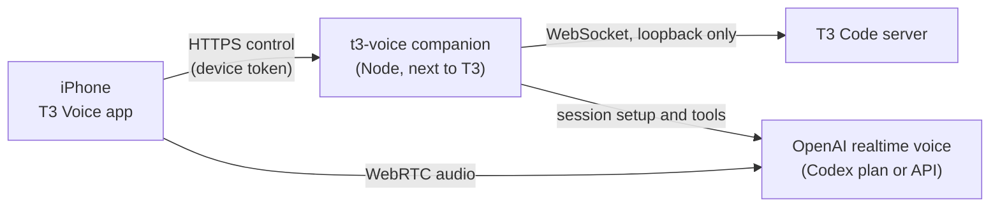

# T3 Voice

**Go for a run. Your coding agents keep working, and you manage them by voice.**

You are 5 km into your run. AirPods in, iPhone locked in your pocket. A voice in your ear:

> 🎧 "The checkout tests task is finished. Claude fixed the three failing tests, and the
> whole suite passes now."

You answer without slowing down:

> 🏃 "Good. Start Codex on the API project to add rate limiting to the login route."
>
> 🎧 "Started: Codex, on API, add rate limiting to the login route."

You come home with a clear head and two tasks done.

<!-- Demo video: drag the .mp4 file here in GitHub's web editor. -->

## Why

Coding agents changed the job. You no longer type the code: you give direction, then you
wait, then you check. Giving direction does not need a screen. But today the tools keep
you at the desk: you watch a terminal, in case an agent finishes or asks you something.

T3 Voice cuts that cord. Your agents work on your server. You run, walk the dog, cook or
drive, and you manage them the way you would manage a team on the phone: you ask what is
going on, you hand out work, and you hear about it when something is done or blocked.

T3 Voice is an **unofficial**, community-made companion for
[T3 Code](https://github.com/pingdotgg/t3code), the app that runs coding agents (Claude,
Codex) on your own server. It is not made or endorsed by the T3 Code team. The dream is
that voice becomes a part of T3 Code itself one day: if the team wants this work, it is
MIT-licensed for that reason.

> **Status: early MVP, French only.** It works end to end on the author's own T3 server.
> The assistant speaks French today (the dialogue above is translated), and the app UI is
> in French. English is the most wanted contribution: see [Contributing](#contributing).

## What it does today

- **Start without looking**: press the Action Button or say "Hey Siri", pass Face ID, talk.
- **Keep talking with the screen locked**, phone in your pocket, with AirPods or the
  built-in mic. A Live Activity shows that the mic is on.
- **Ask about your server**: what runs now, what finished today, your projects, the
  details of a task.
- **Start and steer tasks**: start Claude or Codex on a project, send a follow-up, stop a
  task after a spoken "yes".
- **Hear it when it happens**: the assistant tells you in your ear when a followed task
  finishes or fails, with a 2–3 sentence summary.
- **Control the cost**: mute, an automatic stop after a silence, and a daily budget.
  Voice runs on your ChatGPT plan (Codex) or on the OpenAI API (GPT-Live) when the plan's
  quota runs low.

On the roadmap: answer agent questions and permission requests by voice ([#23](https://github.com/thomaseude/t3code-voice/issues/23)), push
notifications when no conversation is open ([#25](https://github.com/thomaseude/t3code-voice/issues/25)), and automatic resume after a phone call
or a network drop ([#26](https://github.com/thomaseude/t3code-voice/issues/26)). The full spec is issue [#15](https://github.com/thomaseude/t3code-voice/issues/15).

## How it works

- **The iPhone app** ([`ios/`](ios/), Swift/SwiftUI, iOS 18+) carries only the audio and a
  small control channel. It has no access to T3 and holds no API key.
- **The companion** ([`companion/`](companion/), TypeScript on Node 22.18+) runs on the
  same machine as T3 and talks to it on loopback. It opens the voice sessions, and the voice
  model acts on T3 through the companion's tools: list, start, follow, stop.
- **Security is closed by default.** You pair the iPhone with a one-time QR code. The
  companion rejects every request without a device token, rate-limits every route, and
  refuses to start against a T3 version it was not tested with. Logs carry no audio, no
  transcripts and no code.

## Get started

You need a T3 Code server, Node 22.18 or later on that server, a public HTTPS address for
the companion (a Cloudflare Tunnel works), a Mac with Xcode, and an iPhone on iOS 18 or
later. A free Apple developer account is enough.

1. **Companion**: install it, pair it with T3, run it as a service and publish it over
   HTTPS. Follow [`companion/README.md`](companion/README.md).
2. **iPhone app**: build it with Xcode and XcodeGen. Follow [`ios/README.md`](ios/README.md).
3. **Pair**: run `t3-voice pair` on the server and scan the QR code with the app.

The app is not on the App Store or TestFlight yet, so you build it yourself.

## Contributing

Help is welcome, and the code is built to be easy to enter: a hexagonal architecture, fast
unit tests with fakes, and one issue per feature with its acceptance criteria.

- Start with [`CONTRIBUTING.md`](CONTRIBUTING.md).
- Pick an issue labelled
  [`good first issue`](https://github.com/thomaseude/t3code-voice/labels/good%20first%20issue)
  or [`help wanted`](https://github.com/thomaseude/t3code-voice/labels/help%20wanted).
- Questions and ideas go to
  [Discussions](https://github.com/thomaseude/t3code-voice/discussions).

Most wanted: **English** (and other languages) for the assistant and the app. You do not
need a Mac for the companion: it is plain TypeScript, tested on Linux.

## License

[MIT](LICENSE). T3 Voice is an unofficial project. It is not affiliated with, or endorsed
by, T3 Tools, Inc. or the T3 Code team.
